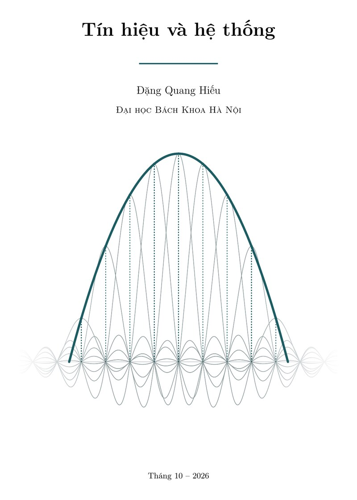

## Tín hiệu và hệ thống 

Môn *Tín hiệu và hệ thống* (THHT) được ĐHBK HN đưa vào chương trình giảng dạy từ đầu những năm 2010. Tôi được giao nhiệm vụ soạn đề cương để dạy sinh viên năm 2-3 với vai trò là môn cơ sở của ngành Điện tử - Viễn thông. Đến nay đã có đủ bài giảng và slides cho môn học. 

---

### Bài giảng Tín hiệu và hệ thống

Tôi đã hoàn thành cuốn *Tín hiệu và hệ thống*. 

Tải phiên bản mới nhất [ở đây](https://github.com/dangquanghieu/book-thht/releases/latest/download/TinHieuHeThong.pdf)

---

### Các bài lab đồng hành 

Viết bằng Python và jupyter notebooks. Đang hoàn thiện. Xem [ở đây](https://github.com/dangquanghieu/tinhieu-hethong-notebooks) 

---

### Slides

Tôi đang soạn lại slides. Bản cũ có thể lấy link ở dưới. 

[Slides cho môn THHT](https://www.dropbox.com/scl/fo/no18vz6yqwm11rpaqrxs1/AKRt0rDDmsb-oFh06nUKAr4?rlkey=4dk1h8p1mqn1m7pe8syg1p7y6&st=pbppgd20&dl=0) 

